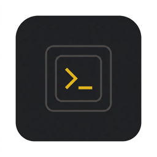

<div align="center">
  
  <h1>monkeytype-tui</h1>
  <p>A fast, minimalist terminal typing test with native Kitty cursor trail support, ASCII animations, and live DMS theme sync.</p>

  <p>
    <a href="https://github.com/bhavyam2468/monkeytype-tui/releases/latest">
      
    </a>
    <a href="https://github.com/bhavyam2468/monkeytype-tui/blob/main/LICENSE">
      
    </a>
    
    
    <a href="https://github.com/bhavyam2468/monkeytype-tui/actions/workflows/release.yml">
      
    </a>
  </p>
</div>

---

## Features

- **Authentic Typing Modes**: `time` (15s, 30s, 60s, 120s), `words` (10, 25, 50, 100), and `quote` mode with optional `@ punct` and `# nums` modifiers.
- **Native Kitty Cursor Trail Support**: Positions the real terminal hardware cursor on every keystroke and line wrap so Kitty's GPU `cursor_trail` works natively inside the app. Includes an optional software RGB trail (`Ctrl+L`) for other terminals.
- **60 FPS Animations & Effects (All Toggleable in Settings)**:
  - **Line Scroll Fade**: Smoothly fades in newly revealed lines as the 3-line viewport advances.
  - **Pace Caret (Ghost Racer)**: Dimmed ghost cursor moving at your personal best WPM so you can race your own PB live.
  - **Restart Scramble**: Brief glitch-decode sweep across newly generated words on restart.
  - **Combo Aura & PB Confetti**: Breathing streak progress bar at 25x+ combos and gentle ASCII confetti rain on new personal bests.
  - **Typo Micro-Shake**: Tactile 1-cell horizontal nudge on missed keystrokes.
  - **Smooth Theme Cross-Fade**: RGB interpolation when switching themes (`F2`) or when DMS updates your system palette.
  - **ASCII Mascot, Word Sparks & Keystroke Wave**: Reactive typing mascot, floating sparks, and live equalizer wave.
  - Press **`F3`** (or select `settings` in the `Esc` bar) to toggle any effect individually or switch to Zen mode (`n`). Settings persist in `~/.local/share/monkeytype-tui/settings.json`.
- **Centered Results Dashboard**: Animated WPM and accuracy count-up, full-width interpolated WPM-over-time chart with error markers, raw WPM, consistency, max combo, and character breakdown (`correct/incorrect/extra/missed`).
- **Live DMS Theme Sync**: Automatically reads `~/.cache/dms/dms-colors.json` from DankMaterialShell (dark and light mode) and hot-reloads colors when your system theme changes.
- **Built-in Color Themes**: `dms_sync`, `serika_dark`, `catppuccin`, `dracula`, `nord`, `gruvbox`, and `matrix`.
- **Local Stats & Personal Bests**: Saves completed tests, personal bests per mode, and recent history in `~/.local/share/monkeytype-tui/stats.json`.

---

## Installation

Pre-built Linux packages are available on the [Releases](https://github.com/bhavyam2468/monkeytype-tui/releases/latest) page.

### AppImage (Universal Linux)

```bash
chmod +x monkeytype-tui-0.2.0-x86_64.AppImage
./monkeytype-tui-0.2.0-x86_64.AppImage
```

### Debian / Ubuntu (`.deb`)

```bash
sudo apt install ./monkeytype-tui_0.2.0_amd64.deb
monkeytype-tui
```

### Arch Linux (`.pkg.tar.zst` / `PKGBUILD`)

```bash
sudo pacman -U monkeytype-tui-0.2.0-1-x86_64.pkg.tar.zst
```

Or build locally from the included `PKGBUILD`:

```bash
cd packaging && makepkg -si
```

### Standalone Binary Tarball (`.tar.gz`)

```bash
tar -xzf monkeytype-tui-0.2.0-x86_64-linux.tar.gz
cd monkeytype-tui-0.2.0-x86_64-linux
./monkeytype-tui
```

### Build from Source (Cargo)

```bash
git clone https://github.com/bhavyam2468/monkeytype-tui.git
cd monkeytype-tui
cargo build --release
./target/release/monkeytype-tui
```

---

## Keybindings

| Key | Action |
| :--- | :--- |
| `Tab` | Instant restart with new words |
| `Ctrl+R` | Repeat the same words |
| `Ctrl+W` / `Ctrl+Backspace` | Delete current word |
| `F2` / `Alt+T` | Cycle color theme |
| `F3` | Open animation and visual settings modal |
| `Ctrl+L` | Toggle software RGB cursor trail |
| `Ctrl+K` | Cycle caret style (when software trail is active) |
| `Esc` | Open or close config bar (`Left`/`Right` + `Enter`, `q` to quit) |
| `Ctrl+C` | Quit immediately |

On the results screen: `Tab` / `Enter` / `n` starts a new test, `r` repeats the same words, `t` cycles themes, and `Esc` / `q` quits.

---

## CLI Options

```bash
monkeytype-tui --mode words --words 50 --punctuation --numbers --theme catppuccin
monkeytype-tui --mode quote
monkeytype-tui --stats
```

| Flag | Description | Default |
| :--- | :--- | :--- |
| `-m, --mode` | Test mode (`time`, `words`, `quote`) | `time` |
| `-t, --time` | Duration in seconds (`15`, `30`, `60`, `120`) | `30` |
| `-w, --words` | Word count (`10`, `25`, `50`, `100`) | `25` |
| `-p, --punctuation` | Include punctuation | `false` |
| `-n, --numbers` | Include numbers | `false` |
| `--theme` | Theme name (`dms_sync`, `serika_dark`, `catppuccin`, `dracula`, `nord`, `gruvbox`, `matrix`) | `dms_sync` |
| `--stats` | Print personal bests and exit | `false` |

---

## DankMaterialShell (DMS) Theme Sync

When `~/.cache/dms/dms-colors.json` (or `$XDG_CACHE_HOME/dms/dms-colors.json`) is present, `monkeytype-tui` defaults to `dms_sync` and polls the file every second. Switching wallpapers or toggling dark/light mode in DMS updates the terminal palette live without restarting the app.

---

## License

MIT License. See [LICENSE](LICENSE) for details.
